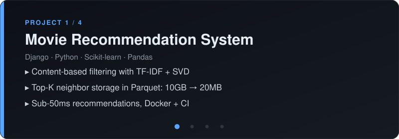

## 🛠️ Skills

 
 

## 🚀 Featured Projects

| Project | Link |
|---|---|
| Movie Recommendation System | [Repo](https://github.com/poddarchhatri-source/Movie-Recommendation-System) |
| Job Application Tracker | [Repo](https://github.com/poddarchhatri-source/Job-Application-Tracker) |
| FoodBridge | [Repo](https://github.com/poddarchhatri-source/FoodBridge) |
| News Verification System | [Repo](https://github.com/poddarchhatri-source/News-Verification-System) |

## 📈 Problem Solving

360+ problems solved on LeetCode, synced to [75-Days-LeetCode-Challenge](https://github.com/poddarchhatri-source/75-Days-LeetCode-Challenge)

## 📫 Reach Me

[LinkedIn](https://linkedin.com/in/prince-poddar-873327375) · poddarchhatri@gmail.com
